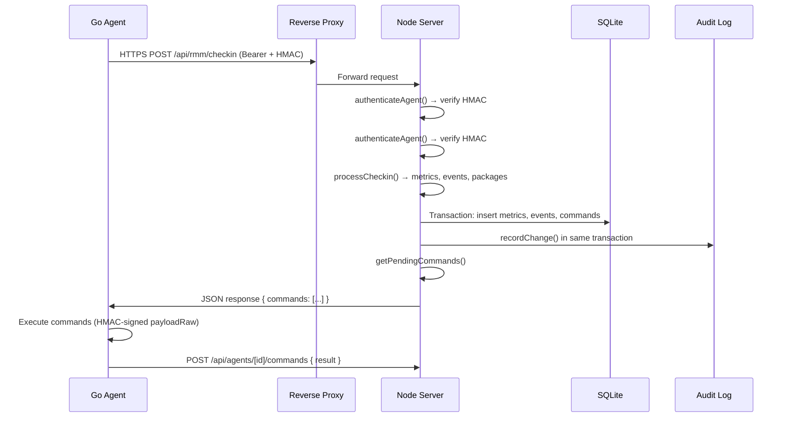
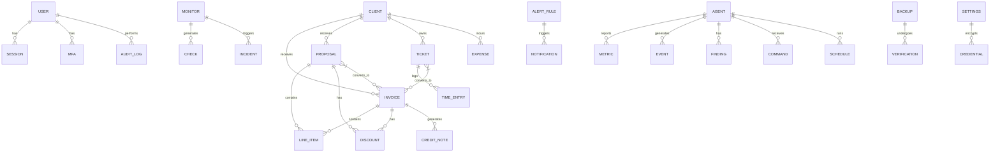

# ITCake Architecture Diagram

```mermaid
graph TB
    subgraph "External"
        Browser["🌐 Browser"]
        Agent["🤖 Go Agent\n(macOS/Linux/Windows)"]
        Proxy["🔒 Reverse Proxy\n(Caddy/nginx/Cloudflare)"]
        SMTP["📧 SMTP Server"]
        Telegram["📱 Telegram Bot"]
        Anthropic["🤖 Anthropic API"]
        Uptime["🌍 Uptime Targets"]
    end

    Proxy -->|TLS Termination| Server["🟢 Node.js Server\nSvelteKit 3 + adapter-node"]

    subgraph "Server"
        Server -->|API| API["/api/*"]
        Server -->|Pages| UI["/(app)/*"]
    end

    subgraph "Core Services"
        Auth["🔐 Auth\nSessions + MFA + Step-up"]
        Audit["📜 Audit Log\nHMAC Chain + Anchor"]
        Crypto["🔐 Field Crypto\nAES-256-GCM + AAD"]
        Rate["🚦 Rate Limit\nPer-IP/Email/Global"]
    end

    subgraph "Business Logic"
        Invoices["📄 Invoices\n+ Credit Notes + Proposals"]
        Tickets["🎫 Tickets\nTime Tracking → Invoice"]
        UptimeSvc["📊 Uptime\nPing/HTTP/SSL/Domain"]
        Clients["👥 Clients + Catalog"]
        Reports["📈 Reports\nRevenue/Tax/Client"]
        Backups["💾 Backups\nZIP + AES-256-GCM"]
        RMM["🤖 RMM Agent Mgmt\nCheckin/Commands/Updates"]
        Remote["🖥️ Remote Desktop\nGuacamole (guacd)"]
        Alerts["🚨 Alert Rules\nTelegram/Email"]
        AI["🤖 AI Assistant\nTools + Budget"]
    end

    subgraph "Storage"
        DB[("🗄️ SQLite\nbetter-sqlite3 WAL")]
        Files["📁 DATA_DIR\nUploads/Backups/Agent bins"]
    end

    %% Connections
    API --> Auth
    API --> Audit
    API --> Crypto
    API --> Rate
    
    Auth --> Invoices
    Auth --> Tickets
    Auth --> UptimeSvc
    Auth --> Clients
    Auth --> Reports
    Auth --> Backups
    Auth --> RMM
    Auth --> Remote
    Auth --> Alerts
    Auth --> AI

    Invoices --> DB
    Tickets --> DB
    UptimeSvc --> DB
    Clients --> DB
    Reports --> DB
    Backups --> DB
    RMM --> DB
    Remote --> DB
    Alerts --> DB
    AI --> DB

    Backups --> Files
    RMM --> Files
    Remote --> Files

    %% External integrations
    Server -.->|TLS Pinning| Agent
    Agent -.->|Bearer + HMAC| Server
    Server -.->|SMTP| SMTP
    Server -.->|Bot API| Telegram
    Server -.->|Messages| Anthropic
    Server -.->|Ping/HTTP/SSL/RDAP| Uptime
    Server -.->|Pinning| SMTP
    Server -.->|Pinning| Telegram
    Server -.->|Pinning| Anthropic
```

---

## Component Overview

```
┌─────────────────────────────────────────────────────────────────────────────┐
│                              ITCake Architecture                            │
├─────────────────────────────────────────────────────────────────────────────┤
│                                                                             │
│  ┌─────────────┐    ┌──────────────────┐    ┌──────────────────────────┐   │
│  │   Browser   │    │   Go Agent       │    │   External Services      │   │
│  │  (User UI)  │    │  (RMM Agent)     │    │  SMTP / Telegram / AI   │
│  └──────┬──────┘    └────────┬─────────┘    └────────────┬─────────────┘   │
│         │                    │                       │                    │
│         ▼                    ▼                       ▼                    │
│  ┌─────────────────────────────────────────────────────────────────┐     │
│  │                    REVERSE PROXY (Caddy/nginx)                  │     │
│  │                    TLS Termination + Rate Limit                 │     │
│  └────────────────────────────┬────────────────────────────────────┘     │
│                               │                                          │
│                               ▼                                          │
│  ┌─────────────────────────────────────────────────────────────────┐     │
│  │                     NODE.JS SERVER (SvelteKit 3)                │     │
│  ├─────────────────────────────────────────────────────────────────┤     │
│  │  ┌─────────┐  ┌─────────┐  ┌─────────┐  ┌───────────────────┐  │     │
│  │  │  Auth   │  │  Audit  │  │  Crypto │  │     Rate Limit     │     │
│  │  │ MFA+Step│  │ HMAC    │  │ AES-256 │  │ Per-IP/Email/Glob │     │
│  │  └────┬────┘  └────┬────┘  └────┬────┘  └────────┬──────────┘     │
│  └───────┼────────────┼────────────┼────────────────┼───────────────┘     │
│          │            │            │            │                         │
│          ▼            ▼            ▼            ▼                         │
│  ┌─────────────────────────────────────────────────────────────────┐     │
│  │                    BUSINESS LOGIC SERVICES                      │     │
│  ├─────────┬─────────┬─────────┬─────────┬─────────┬──────────────┤     │
│  │Invoices │ Tickets │ Uptime  │ Clients │ Reports │  Backups     │     │
│  ├─────────┼─────────┼─────────┼─────────┼─────────┼──────────────┤     │
│  │ RMM     │ Remote  │ Alerts  │   AI    │  Settings              │     │
│  └─────────┴─────────┴─────────┴─────────┴─────────┴──────────────┘     │
│                                                                             │
│  ┌─────────────────────────────────────────────────────────────────┐     │
│  │                        STORAGE LAYER                             │     │
│  │  ┌─────────────────────┐        ┌──────────────────────────┐   │     │
│  │  │    SQLite (WAL)      │        │       DATA_DIR           │   │
│  │  │  better-sqlite3      │        │  Uploads / Backups       │   │
│  │  │  (ACID + WAL)        │        │  Agent bins / Recordings │   │
│  │  └─────────────────────┘        └──────────────────────────┘   │     │
│  └─────────────────────────────────────────────────────────────────┘     │
│                                                                             │
└─────────────────────────────────────────────────────────────────────────────┘
```

---

## Data Flow: Agent Check-in



---

## Security Layers

```
┌─────────────────────────────────────────────────────────────────┐
│                      SECURITY LAYERS                            │
├─────────────────────────────────────────────────────────────────┤
│                                                                 │
│  NETWORK          │ TLS 1.3 + Pinned TLS (Agent)               │
│                   │ HSTS + CSP + COOP/CORP + Permissions-Policy │
│                   │ Reverse Proxy Rate Limit                    │
├───────────────────┼────────────────────────────────────────────┤
│  APPLICATION      │ Session: HMAC-SHA256 + Secure/HttpOnly     │
│                   │ MFA: TOTP + Recovery Codes                 │
│                   │ Step-Up: MFA code required for sensitive   │
│                   │ CSRF: Origin/Referer + SameSite=Strict     │
├───────────────────┼────────────────────────────────────────────┤
│  AUTHORIZATION    │ requireUser / requireAdmin                 │
│                   │ MFA Step-Up on sensitive actions           │
│                   │ Agent: Bearer + HMAC per command           │
├───────────────────┼────────────────────────────────────────────┤
│  DATA             │ Field-level AES-256-GCM + AAD              │
│                   │ scrypt N=131072 key derivation             │
│                   │ Backup: separate passphrase + AES-256-GCM  │
│                   │ Agent tokens: separate pepper              │
├───────────────────┼────────────────────────────────────────────┤
│  AUDIT            │ HMAC-SHA256 chained log                    │
│                   │ Anchor + History snapshots                 │
│                   │ Truncation detection                       │
└─────────────────────────────────────────────────────────────────┘
```

---

## Data Model (Simplified)



---

## Quick Reference: Key Files

| Layer | Key Files |
|-------|-----------|
| **Entry** | `src/routes/+layout.server.ts`, `src/hooks.server.ts` |
| **Auth** | `src/lib/server/auth.ts`, `src/lib/server/mfa-step-up.ts` |
| **Audit** | `src/lib/server/changes.ts`, `src/lib/server/db.ts` |
| **Crypto** | `src/lib/server/field-crypto.ts`, `src/lib/secret-mask.ts` |
| **Rate Limit** | `src/lib/server/rate-limit.ts` |
| **Services** | `src/services/*.ts` (27 files) |
| **API** | `src/routes/api/**/+server.ts` |
| **UI** | `src/routes/(app)/**/+page.svelte`, `src/lib/components/**` |
| **Agent** | `agent/cmd/agent/`, `agent/internal/*` |
| **Tests** | `tests/unit/*.test.ts`, `tests/integration/lifecycle.test.ts` |

---

*Generated for ITCake v0.1.0 — Architecture as of 2026-10-19*
